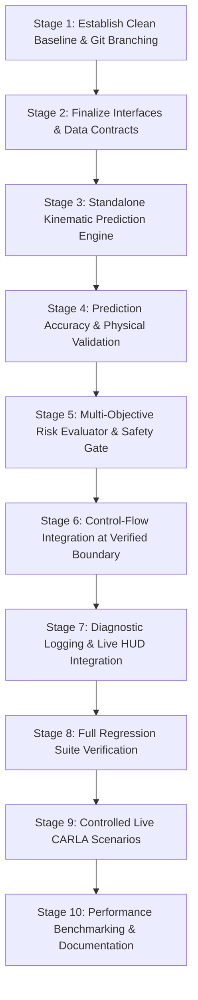

# Module 3: Incremental Implementation Roadmap

**Document Status:** Implementation Roadmap & Engineering Plan  
**Notice:** This document defines the engineering stages for future implementation. **NO IMPLEMENTATION CODE IS CREATED DURING THIS STAGE.**  
**Project:** Intelligent Weather-Aware Autonomous Vehicle Platooning System using MAPPO in CARLA  

---

## 1. Overview & Phased Implementation Strategy

Module 3 (Twin-World Safety Projection System) must be developed incrementally across 10 sequential stages to guarantee that Module 2 remains fully operational, deterministic, and regression-free at all times.

---

## 2. Stage-by-Stage Implementation Roadmap

### Stage 1: Establish Clean Baseline & Git Protection
- **Objective:** Lock the working Module 2 baseline, verify all existing unit tests pass, and create a dedicated branch/backup.
- **Files Created/Modified:** None (operational setup only).
- **Dependencies:** None.
- **Acceptance Criteria:**
  - `py -3.7 -m unittest Module2.tests.test_module2_logic` passes 31/31 tests with zero failures.
  - Active checkpoint `checkpoints/mappo_checkpoint.pt` is archived in `backup/`.
- **Tests Required:** Full 31-test Module 2 logic suite.
- **Rollback Strategy:** Immediate Git stash/checkout if tests fail.
- **Risks & Open Decisions:** None.

---

### Stage 2: Finalize Interfaces & Data Contracts
- **Objective:** Create the Module 3 directory package (`WindowsNoEditor/Module3/`) and implement clean data classes for state snapshots, candidate requests, trajectories, and safety decision reports.
- **Files Expected to be Created:**
  - `WindowsNoEditor/Module3/__init__.py`
  - `WindowsNoEditor/Module3/config.py`
  - `WindowsNoEditor/Module3/interfaces/snapshot.py`
  - `WindowsNoEditor/Module3/interfaces/decision.py`
  - `WindowsNoEditor/Module3/interfaces/reason_codes.py`
- **Dependencies:** Stage 1.
- **Acceptance Criteria:**
  - Python classes import cleanly without errors in Python 3.7.9.
  - Serialization and deserialization to JSON/dict functions with 100% round-trip fidelity.
- **Tests Required:** Schema validation unit tests (`test_interfaces.py`).
- **Rollback Strategy:** Delete `WindowsNoEditor/Module3/interfaces/`.
- **Risks & Open Decisions:** Finalizing exact float precision for telemetry logging.

---

### Stage 3: Standalone Kinematic Prediction Engine
- **Objective:** Implement the friction-bounded kinematic bicycle rollout model in pure NumPy.
- **Files Expected to be Created:**
  - `WindowsNoEditor/Module3/projection/kinematic_model.py`
  - `WindowsNoEditor/Module3/projection/rollout_engine.py`
- **Dependencies:** Stage 2.
- **Acceptance Criteria:**
  - Computes 20-step forward rollout across $T = 2.0$s in $< 1.0$ ms per vehicle.
  - Accurately bounds longitudinal acceleration by tire-road friction $\mu \times g$.
  - Generates zero side effects in CARLA or external memory.
- **Tests Required:** `test_kinematic_rollout_accuracy.py` comparing analytical integration against Euler stepping.
- **Rollback Strategy:** Revert Stage 3 files.
- **Risks & Open Decisions:** Validating whether constant-turn-rate assumption is sufficient for sharp 90-degree urban turns.

---

### Stage 4: Prediction Accuracy & Physical Validation
- **Objective:** Validate virtual predictions against real CARLA vehicle physics under varied weather presets (Clear vs. Rain vs. Fog).
- **Files Expected to be Created:**
  - `WindowsNoEditor/Module3/tests/test_prediction_accuracy.py`
- **Dependencies:** Stage 3.
- **Acceptance Criteria:**
  - Position error between predicted trajectory and actual CARLA vehicle position over 1.0s is $< 0.8$m.
  - Braking distance error under low friction ($\mu = 0.4$) is $< 10\%$.
- **Tests Required:** Closed-loop open-loop trajectory comparison tests.
- **Rollback Strategy:** Refine vehicle wheelbase and tire friction calibration constants.
- **Risks & Open Decisions:** CARLA 0.9.9 PhysX engine vehicle inertia differences across different car blueprints.

---

### Stage 5: Multi-Objective Risk Evaluator & Safety Gate
- **Objective:** Implement the safety arbitration gate: TTC calculator, headway evaluator, stop-line overshoot detector, and candidate action substitution ladder.
- **Files Expected to be Created:**
  - `WindowsNoEditor/Module3/risk/ttc_evaluator.py`
  - `WindowsNoEditor/Module3/risk/headway_evaluator.py`
  - `WindowsNoEditor/Module3/risk/signal_evaluator.py`
  - `WindowsNoEditor/Module3/decision/safety_gate.py`
- **Dependencies:** Stage 4.
- **Acceptance Criteria:**
  - Appropriately approves safe candidate actions without false-positive interventions.
  - Automatically substitutes `CRUISE` $\to$ `DECELERATE` $\to$ `BRAKE` when safety margins are violated.
  - Emits standardized `M3_*` reason codes.
- **Tests Required:** Offline synthetic scenario suite (`test_safety_gate.py`, Scenarios SC-01 through SC-12).
- **Rollback Strategy:** Revert Stage 5 files.
- **Risks & Open Decisions:** Tuning the threshold tradeoff between overly conservative phantom braking and aggressive following.

---

### Stage 6: Control-Flow Integration at Verified Boundary
- **Objective:** Wire Module 3 into the authoritative control flow between `Module2Manager` and `MissionPlatoonController` in `run_module_2.py`.
- **Files Expected to be Modified:**
  - `WindowsNoEditor/PythonAPI/run_module_2.py` (lines 770–785)
  - `WindowsNoEditor/Module2/module2_manager.py` (optional adapter hook)
- **Dependencies:** Stage 5.
- **Acceptance Criteria:**
  - Module 3 receives `TwinWorldSnapshot` and candidate tactical actions from MAPPO.
  - Controller receives approved/substituted action $a^*$ and executes low-level actuation.
  - Module 2 observation dimensions (32-D) and PPO training loop remain completely untouched.
- **Tests Required:** Smoke test running simulation for 60 seconds with live Module 3 filtering active.
- **Rollback Strategy:** Toggle `ENABLE_MODULE3 = False` flag in `config.py` to restore baseline Module 2 execution immediately.
- **Risks & Open Decisions:** Ensuring thread safety between CARLA simulation thread and Module 3 evaluators.

---

### Stage 7: Diagnostic Logging & Live HUD Integration
- **Objective:** Stream Module 3 predictive risk metrics, overrides, and reason codes into `mappo_decisions.log`, `uncertain_platoon.log`, and the live HUD.
- **Files Expected to be Modified:**
  - `WindowsNoEditor/Module2/mission_controller.py` (decision logging buffer)
  - `WindowsNoEditor/PythonAPI/live_log_monitor.py` (ANSI formatting for `[MODULE 3]` tags)
  - `WindowsNoEditor/PythonAPI/autopilot_platoon_window.py` (HUD predictive safety widget)
- **Dependencies:** Stage 6.
- **Acceptance Criteria:**
  - `mappo_decisions.log` includes `m3_evaluated=True`, `m3_override_reason`, `m3_min_ttc`.
  - Live HUD displays predictive safety status: green `PREDICTIVE SAFE` or red `M3 OVERRIDE: TTC < 1.8s`.
- **Tests Required:** Visual HUD verification and log parsing unit test.
- **Rollback Strategy:** Revert logging additions.
- **Risks & Open Decisions:** Keeping HUD render loop at 60 FPS without UI stutter.

---

### Stage 8: Full Regression Suite Verification
- **Objective:** Execute the entire combined test suite across Module 2 and Module 3.
- **Files Expected to be Modified:** None.
- **Dependencies:** Stage 7.
- **Acceptance Criteria:**
  - All 31 Module 2 unit tests pass 100%.
  - All new Module 3 offline tests pass 100%.
  - Total test run completes in $< 5.0$ seconds.
- **Tests Required:** `py -3.7 -m unittest discover -s WindowsNoEditor/Module2/tests` and `Module3/tests`.
- **Rollback Strategy:** Isolate and fix any regression before moving to live CARLA testing.
- **Risks & Open Decisions:** None.

---

### Stage 9: Controlled Live CARLA Scenarios
- **Objective:** Execute live evaluation runs in CARLA Town05 against the 12 core safety scenarios (SC-01 to SC-12).
- **Files Expected to be Modified:** None (runtime validation).
- **Dependencies:** Stage 8.
- **Acceptance Criteria:**
  - **Zero red-light crossings** across 10 trials.
  - **Zero platoon rear-end collisions** during sudden leader braking under wet conditions ($\mu = 0.4$).
  - **Zero collisions** during Ghost Driver cut-ins.
- **Tests Required:** Automated scenario runner scripts in CARLA.
- **Rollback Strategy:** Tune safety threshold parameters in `Module3/config.py`.
- **Risks & Open Decisions:** CARLA server stability during prolonged continuous runs.

---

### Stage 10: Performance Benchmarking & Documentation
- **Objective:** Profile computational latency, verify 30 Hz real-time pacing, document final system performance, and package production codebase.
- **Files Expected to be Created/Modified:**
  - `project_docs/MODULE3_FINAL_VERIFICATION_REPORT.md`
- **Dependencies:** Stage 9.
- **Acceptance Criteria:**
  - Average Module 3 evaluation latency is documented at $< 3.5$ ms.
  - Simulation loop maintains $\ge 28.0$ FPS.
- **Tests Required:** 1,000-cycle latency benchmark profiling run.
- **Rollback Strategy:** None.
- **Risks & Open Decisions:** Final user review and architectural approval.

