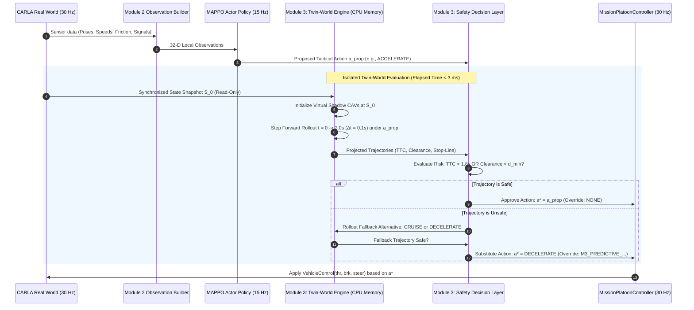

# Module 3: Prediction & Safety Architecture Design

**Document Status:** Architectural Design & Engineering Specification  
**Design Phase:** Pre-Implementation Design  
**Notice:** All designs and algorithms in this document are **PROPOSED — NOT YET IMPLEMENTED**.  
**Project:** Intelligent Weather-Aware Autonomous Vehicle Platooning System using MAPPO in CARLA  

---

## 1. Architectural Trade-Off Analysis: Digital Twin Approaches

A central question in designing a "Twin-World Safety Projection System" is how the virtual world is physically realized. We analyze four candidate architectural patterns against the verified project environment (CARLA 0.9.9, Python 3.7.9, PyTorch 1.13.1, Windows x64, 30 Hz control loop):

| Architectural Paradigm | Implementation Mechanism | Latency per Cycle | VRAM / CPU Overhead | CARLA 0.9.9 Feasibility | Audit Recommendation |
| :--- | :--- | :---: | :---: | :---: | :---: |
| **Approach 1: Conventional Rule-Based Filter** | Static threshold checks on current distance & speed ($d < 3.8\text{m}$). | $< 0.1$ ms | Zero | Verified existing in Module 2 | **REJECT AS INSUFFICIENT:** Purely reactive; cannot predict future dynamic hazards. |
| **Approach 2: Forward Kinematic Rollout (NumPy Bicycle Model)** | Analytical numerical integration of discrete kinematic bicycle model in CPU memory. | **0.8 – 2.5 ms** | **< 10 MB RAM / 0 VRAM** | **Fully Supported & Optimal** | **STRONGLY RECOMMENDED:** Extremely fast, zero GPU overhead, mathematically verifiable, perfectly isolated. |
| **Approach 3: Synchronized Shadow Simulator (Headless CARLA Sub-World)** | Spawning a second, hidden set of actors in an isolated coordinate bounding box in CARLA. | 25 – 45 ms | High GPU & Unreal Engine overhead | Severe actor interference & collision risk | **REJECT:** Unstable in CARLA 0.9.9; actor leaks and physics interference with real platoon. |
| **Approach 4: Dual CARLA Server Instances** | Running two separate `CarlaUE4.exe` processes on ports 2000 and 2002. | 60 – 120 ms | 2× GPU VRAM (> 6 GB required) | Exceeds hardware limit on RTX 3050 / Low-End PCs | **REJECT:** Violates 30 Hz real-time budget; RPC synchronization bottlenecks. |

### Architectural Recommendation
> [!IMPORTANT]
> **Approach 2 (High-Performance Kinematic Bicycle Model Rollout)** is the only defensible, robust architecture for this project.
> It delivers sub-3-millisecond evaluation latency, operates completely in Python/NumPy memory without touching CARLA server state, incurs zero VRAM penalty, and guarantees deterministic repeatability.

---

## 2. Twin-World Forward Projection Architecture



---

## 3. Mathematical Formulation of the Virtual Prediction Engine

### 1. Longitudinal CAV Kinematics (Bicycle Model with Tire Friction Bound)
For each vehicle $i$ at projection time step $k \in \{0, \dots, K-1\}$ where $t_k = k \Delta t$ ($\Delta t = 0.1$s, $K = 20$):

1. **Candidate Action Speed Delta Mapping:**
   $$v_{\text{target}}(a) = v_{\text{cruise}} + \Delta v(a)$$
   where $\Delta v(\text{ACCELERATE}) = +1.1\text{ m/s}$, $\Delta v(\text{DECELERATE}) = -1.8\text{ m/s}$, $\Delta v(\text{CRUISE}) = 0.0$.
2. **Friction-Bounded Acceleration Integration:**
   The achievable longitudinal acceleration is strictly constrained by Coulomb tire-road friction $\mu$:
   $$a_{\text{cmd}, k} = K_p (v_{\text{target}}(a) - v_{i, k})$$
   $$a_{i, k} = \text{clamp}(a_{\text{cmd}, k}, -a_{\text{max, brake}}(\mu), a_{\text{max, accel}}(\mu))$$
   where:
   $$a_{\text{max, accel}}(\mu) = 2.5 \times \mu \quad (\text{m/s}^2), \qquad a_{\text{max, brake}}(\mu) = 5.0 \times \mu \quad (\text{m/s}^2)$$
3. **State Integration (Euler-Cromer):**
   $$v_{i, k+1} = \max(0.0, v_{i, k} + a_{i, k} \Delta t)$$
   $$x_{i, k+1} = x_{i, k} + v_{i, k+1} \cos(\theta_{i, k}) \Delta t$$
   $$y_{i, k+1} = y_{i, k} + v_{i, k+1} \sin(\theta_{i, k}) \Delta t$$
   $$\theta_{i, k+1} = \theta_{i, k} + \frac{v_{i, k+1}}{L} \tan(\delta_{i, k}) \Delta t$$
   where $L = 2.7$m is the wheelbase, and $\delta_{i, k}$ is the Pure Pursuit steering angle.

---

### 2. Surrounding NPC & Ghost Prediction (Constant-Velocity Constant-Yaw-Rate)
For each non-platoon vehicle $j$ detected within 60m:
$$v_{j, k+1} = v_{j, 0}$$
$$\theta_{j, k+1} = \theta_{j, 0} + \omega_{j, 0} (k \Delta t)$$
$$x_{j, k+1} = x_{j, 0} + v_{j, 0} \cos(\theta_{j, k+1}) \Delta t$$
$$y_{j, k+1} = y_{j, 0} + v_{j, 0} \sin(\theta_{j, k+1}) \Delta t$$

---

## 4. Quantitative Risk Metrics & Acceptance Criteria

### Metric 1: Predictive Time-To-Collision ($\text{TTC}_{\text{proj}}$)
Evaluated between ego vehicle $i$ and any forward obstacle or predecessor vehicle $j$ along the projected trajectory:
$$\Delta x_{ij, k} = \text{proj}_{\text{heading}}(p_{j, k} - p_{i, k}) - L_{\text{veh}}$$
$$v_{\text{close}, ij, k} = \max\left(0.0, v_{i, k} - v_{j, k}\right)$$

$$\text{TTC}_{ij, k} = \begin{cases} 
\frac{\Delta x_{ij, k}}{v_{\text{close}, ij, k}} & \text{if } v_{\text{close}, ij, k} > 0.1 \text{ m/s} \text{ and } \Delta x_{ij, k} > 0 \\
+\infty & \text{otherwise}
\end{cases}$$

$$\text{TTC}_{\text{min}} = \min_{k \in [0, K], j} \text{TTC}_{ij, k}$$
- **Acceptance Criterion:** $\text{TTC}_{\text{min}} \ge 1.8$ seconds.

---

### Metric 2: Dynamic Headway Margin ($H_{\text{margin}}$)
Ensures follower maintains safe separation under worst-case stopping assumptions:
$$d_{\text{safe, min}}(v, \mu) = d_{\text{base}} + \tau_{\text{react}} v + \frac{v^2}{2 \times a_{\text{brake}}(\mu)} - \frac{v_{\text{lead}}^2}{2 \times a_{\text{lead, max}}}$$
Simplified bounded operational rule:
$$d_{\text{safe, min}}(v, \mu) = \max\left(4.0, 1.0 \times v + (1.0 - \mu) \times 8.0\right) \quad \text{meters}$$
$$H_{\text{margin}, k} = \Delta x_{i, i-1, k} - d_{\text{safe, min}}(v_{i, k}, \mu)$$
- **Acceptance Criterion:** $\min_{k} H_{\text{margin}, k} \ge 0.0$ meters.

---

### Metric 3: Traffic Signal Stop-Line Margin ($S_{\text{light}}$)
For vehicles approaching a RED traffic light with stop-line coordinate $x_{\text{stop}}$:
$$S_{\text{overshoot}} = \max_{k \in [0, K]} (x_{i, k} - x_{\text{stop}})$$
- **Acceptance Criterion:** $S_{\text{overshoot}} \le 0.0$ meters (zero stop-line crossing while red).

---

### Metric 4: Lateral Feasibility & Lane Boundary Violation
For candidate lane change actions (`CHANGE_LEFT`, `CHANGE_RIGHT`):
$$e_{\text{lat}, k} = |y_{i, k} - y_{\text{target\_lane, centerline}}|$$
- Rejection condition: if at any time step $k$, the distance to any neighbor vehicle in the target lane is $< 12.0$ meters:
  $$\min_{k, j \in \text{target\_lane}} \|p_{i, k} - p_{j, k}\|_2 < 12.0\text{ m} \implies \text{REJECT}$$

---

## 5. Twin-World Component Blueprint

```
Module3/
├── __init__.py
├── config.py                     # Horizon (2.0s), dt (0.1s), TTC thresholds
├── snapshot/
│   └── state_snapshot.py         # Ingests CARLA actors into TwinWorldSnapshot
├── projection/
│   ├── kinematic_model.py        # Friction-bounded bicycle model
│   └── twin_world_engine.py      # Vectorized NumPy forward rollout engine
├── risk/
│   ├── ttc_calculator.py         # Continuous & discrete TTC evaluation
│   ├── headway_evaluator.py      # Friction-dependent headway boundary check
│   └── signal_evaluator.py       # Stop line intersection & dilemma zone check
└── decision/
    ├── safety_gate.py            # Arbitration ladder (Approve, Substitute, Fallback)
    └── reason_codes.py           # Standardized M3_* reason code definitions
```

### Safety Gate Arbitration Ladder Logic (Pseudocode)
```python
# PROPOSED — NOT YET IMPLEMENTED
class TwinWorldSafetyGate:
    def evaluate(self, snapshot: TwinWorldSnapshot, candidate_request: CandidateActionRequest) -> SafetyDecisionReport:
        t_start = time.perf_counter()
        
        # 1. Evaluate MAPPO Proposed Action
        traj_prop = self.engine.rollout(snapshot, candidate_request.proposed_action)
        risk_prop = self.risk_evaluator.compute_risk(traj_prop, snapshot)
        
        if risk_prop.is_safe:
            return self._build_report(candidate_request.proposed_action, overridden=False, reason="NONE")
            
        # 2. Candidate Substitution Ladder
        for alternative in ["CRUISE", "DECELERATE", "BRAKE"]:
            traj_alt = self.engine.rollout(snapshot, alternative)
            risk_alt = self.risk_evaluator.compute_risk(traj_alt, snapshot)
            if risk_alt.is_safe:
                return self._build_report(
                    approved_action=alternative,
                    overridden=True,
                    reason=risk_prop.primary_violation_code,
                    metrics=risk_alt
                )
                
        # 3. Emergency Halting Fallback
        return self._build_report(
            approved_action="EMERGENCY_BRAKE",
            overridden=True,
            reason="M3_CRITICAL_EMERGENCY_ALL_UNSAFE",
            metrics=risk_prop
        )
```

