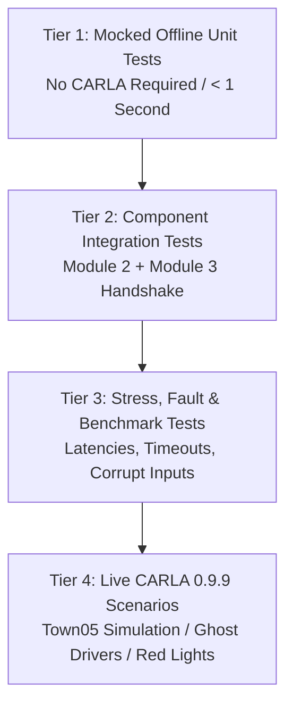

# Module 3: Test & Validation Plan (Twin-World Safety Projection System)

**Document Status:** Test Specification & Validation Protocol  
**Phase:** Pre-Implementation Test Design  
**Notice:** All new Module 3 tests documented here are **PLANNED — NOT YET EXECUTED**.  
**Baseline Status:** Module 2 baseline logic has 31/31 passing unit tests in `WindowsNoEditor/Module2/tests/test_module2_logic.py`.  
**Project:** Intelligent Weather-Aware Autonomous Vehicle Platooning System using MAPPO in CARLA  

---

## 1. Test Architecture & Validation Levels

To ensure zero regressions in Module 2 and prevent simulator crashes, Module 3 follows a strict four-tier test methodology:



### 1. Tier 1: Mocked Offline Unit Tests (`Module3/tests/test_twin_world.py`)
- Executes entirely on synthetic NumPy snapshots without launching the CARLA server.
- Verifies mathematical accuracy of the bicycle kinematic model, numerical integration stability, TTC calculation, and safety gate arbitration.

### 2. Tier 2: Interface Handshake Integration Tests
- Validates bidirectional data flow between `Module2Manager`, `ObservationBuilder`, `MissionPlatoonController`, and Module 3.
- Verifies that decision records in `mappo_decisions.log` contain both MAPPO's proposed action and Module 3's final approved action with risk metrics.

### 3. Tier 3: Benchmark & Fault-Injection Tests
- Measures execution latency per forward rollout across 10,000 synthetic iterations.
- Injects NaN/Inf vectors, missing predecessor IDs, disconnected route waypoints, and forced processing delays to verify fail-safe behavior.

### 4. Tier 4: Live CARLA 0.9.9 Closed-Loop Scenarios
- Live evaluation in Town05 with active weather shifts, traffic lights, and Ghost Driver adversarial intrusions.

---

## 2. Core Safety Scenario Test Matrix

Every scenario defines initial conditions, proposed action, expected prediction, expected decision, pass criteria, and required diagnostic logs.

| Test ID | Scenario Name | Initial Conditions | Proposed MAPPO Action | Expected Virtual Prediction | Expected Safety Decision | Pass Criteria | Required Log Indicators |
| :---: | :--- | :--- | :--- | :--- | :--- | :--- | :--- |
| **SC-01** | **Clear Road Cruise Approval** | Clear road ahead, gap $= 15$m to predecessor, speed $= 25$ km/h, $\mu = 1.0$. | `CRUISE` | $\text{TTC} = \infty$, clearance remains $> 12$m over $2.0$s. | **APPROVE:** `CRUISE` (No override) | Action executed without change; zero deceleration. | `status=APPROVED`, `override=NONE`, `min_ttc>10.0` |
| **SC-02** | **Approaching Stopped Obstacle** | Vehicle speed $= 30$ km/h, stopped car at $18$m ahead, $\mu = 1.0$. | `ACCELERATE` | Virtual rollout predicts collision at $t = 1.6$s ($\text{TTC} = 1.6\text{s} < 1.8\text{s}$). | **REJECT & OVERRIDE:** Substitute `DECELERATE` or `BRAKE` | Vehicle initiates braking before 15m; zero collision with obstacle. | `status=OVERRIDDEN`, `reason=M3_PREDICTIVE_COLLISION_RISK`, `applied_action=BRAKE` |
| **SC-03** | **Sudden Leader Emergency Stop** | Platoon gap $= 8.0$m, leader brakes at $-4.5\text{ m/s}^2$ from $28$ km/h, $\mu = 1.0$. | `CRUISE` (stale MAPPO policy) | Follower gap shrinks to $< 2.5$m within $1.1$s; $\text{TTC} < 1.2\text{s}$. | **REJECT & OVERRIDE:** Substitute `BRAKE` | Minimum physical clearance never drops below $3.0$m; zero rear-end impact. | `status=OVERRIDDEN`, `reason=M3_INSUFFICIENT_FUTURE_HEADWAY`, `applied_action=BRAKE` |
| **SC-04** | **Follower Too Close** | Follower bumper gap $= 4.5$m, relative speed $= 0$, $\mu = 0.9$. | `ACCELERATE` | Headway boundary violated; predicted gap at $2.0$s is $< 3.2$m. | **REJECT & OVERRIDE:** Substitute `DECELERATE` | Gap expands toward $d_{\text{desired}} \ge 7.5$m. | `status=OVERRIDDEN`, `reason=M3_INSUFFICIENT_FUTURE_HEADWAY`, `applied_action=DECELERATE` |
| **SC-05** | **Adversarial Ghost Cut-In** | Possessed ghost vehicle initiates cut-in with lateral speed $v_y = 1.8$ m/s toward platoon gap. | `ACCELERATE` | Ghost trajectory intercepts gap at $t = 1.2$s, reducing clearance to $< 2.0$m. | **REJECT & OVERRIDE:** Substitute `DECELERATE` | Platoon splits gracefully, opens gap $\ge 12$m, no emergency collision. | `status=OVERRIDDEN`, `reason=M3_INTRUDING_GHOST_CUT_IN_PROJECTED`, `state=SPLIT` |
| **SC-06** | **Unsafe Lane Change Rejection** | Leader proposes lane change; NPC approaching in adjacent lane at 50 km/h (10m rear). | `CHANGE_LEFT` | Trajectory intercepts adjacent vehicle envelope at $t = 0.9$s. | **REJECT & OVERRIDE:** Substitute `CRUISE` | Leader remains locked in current lane; lateral deviation $< 0.2$m. | `status=OVERRIDDEN`, `reason=M3_LANE_CHANGE_COLLISION_PROJECTED`, `applied_action=CRUISE` |
| **SC-07** | **Red Traffic Signal Ahead** | Approach red light at 28 km/h, stop line is 22m ahead, $\mu = 0.8$. | `ACCELERATE` | Projected trajectory crosses stop line ($S_{\text{overshoot}} = +6.4$m) during red. | **REJECT & OVERRIDE:** Substitute `BRAKE` | Vehicle stops completely with front bumper $\ge 0.5$m before stop line. | `status=OVERRIDDEN`, `reason=M3_PREDICTIVE_RED_LIGHT_OVERSHOOT`, `final_speed=0.0` |
| **SC-08** | **Low-Friction Wet Surface** | Heavy Rain active ($\mu = 0.4$), speed $= 28$ km/h, follower gap $= 10$m. | `ACCELERATE` | Achievable braking deceleration capped at $2.0\text{ m/s}^2$; required stopping distance $= 15.3$m. | **REJECT & OVERRIDE:** Substitute `DECELERATE` | Platoon expands gap to $> 14.0$m to account for low friction. | `status=OVERRIDDEN`, `reason=M3_LOW_FRICTION_STOP_DISTANCE_DEFICIT` |
| **SC-09** | **Route-Lock Restriction** | Single-lane road or fixed route segment without adjacent driving lanes. | `CHANGE_RIGHT` | Virtual world identifies right lane type is `None` or `Sidewalk`. | **REJECT & OVERRIDE:** Substitute `CRUISE` | Vehicle stays on planned route; zero off-road excursion. | `status=OVERRIDDEN`, `reason=M3_ROUTE_LANE_LOCK`, `applied_action=CRUISE` |
| **SC-10** | **Prediction Latency Timeout** | Artificial 20 ms thread sleep injected into twin-world engine. | `ACCELERATE` | Rollout exceeds 12.0 ms computational deadline. | **FAIL-SAFE FALLBACK:** Substitute `CRUISE` | Simulation tick does not stutter; controller falls back gracefully. | `status=FALLBACK_TIMEOUT`, `reason=M3_TIMEOUT_EXCEEDED`, `applied_action=CRUISE` |
| **SC-11** | **All Candidates Unsafe Emergency** | Sudden road blockage at 5m while traveling at 35 km/h. | Any action | Rollout of `CRUISE`, `ACCEL`, and `DECEL` all predict collision. | **EMERGENCY BRAKE:** Maximum clamp $\text{brake} = 1.0$ | Full hard brake applied immediately; deceleration maximized. | `status=OVERRIDDEN`, `reason=M3_CRITICAL_EMERGENCY_ALL_UNSAFE`, `applied_brake=1.0` |
| **SC-12** | **Non-Interference with Safe Actions** | Clear open highway, headway $= 18$m, leader proposes speed adjustment. | `ACCELERATE` | Rollout predicts speed increases safely to 32 km/h; all margins positive. | **APPROVE:** `ACCELERATE` (Zero false-positive override) | Proposed action applied to CARLA; speed increases smoothly. | `status=APPROVED`, `is_overridden=False`, `override=NONE` |

---

## 3. Mocked & Synthetic World Test Specifications

These tests will be implemented in `Module3/tests/test_twin_world.py` and run via `py -3.7 -m unittest`:

```python
# PROPOSED TEST SUITE OUTLINE (NOT YET IMPLEMENTED)
class TestTwinWorldSafetyProjection(unittest.TestCase):
    def test_state_snapshot_serialization(self):
        """Verify state snapshot correctly ingests pose, velocity, and friction."""
        pass

    def test_forward_kinematic_rollout_accuracy(self):
        """Compare analytical bicycle rollout against ground-truth Euler integration."""
        pass

    def test_ttc_metric_boundary_values(self):
        """Verify TTC computes infinity for opening gaps and exact values for closing gaps."""
        pass

    def test_safety_gate_approves_safe_action(self):
        """Confirm no false-positive overrides occur on empty road."""
        pass

    def test_safety_gate_overrides_accelerate_toward_obstacle(self):
        """Confirm ACCELERATE is replaced with DECELERATE when obstacle is within stopping distance."""
        pass

    def test_low_friction_widens_safety_margin(self):
        """Confirm that reducing mu from 1.0 to 0.4 triggers earlier braking overrides."""
        pass

    def test_timeout_triggers_deterministic_fallback(self):
        """Confirm engine falls back safely to CRUISE if budget is exceeded."""
        pass
```

---

## 4. Module 2 Regression Verification Protocol

To verify that adding Module 3 does not break any existing Module 2 functionality, the entire 31-test Module 2 test suite must be executed before and after every integration milestone:

```powershell
$env:PYTHONPATH = "WindowsNoEditor;WindowsNoEditor/PythonAPI;WindowsNoEditor/PythonAPI/carla/dist/carla-0.9.9-py3.7-win-amd64.egg"
py -3.7 -m unittest Module2.tests.test_module2_logic
```

### Acceptance Criteria for Module 2 Non-Regression
1. **100% Pass Rate:** All 31 existing tests in `test_module2_logic.py` must pass with zero errors and zero failures.
2. **Deterministic Checkpoint Loading:** `test_checkpoint_save_and_load_roundtrip` and `test_checkpoint_atomic_save_and_hash_advancement` must pass without altering file SHA-256 hashes.
3. **Observation Vector Invariance:** The 32-dimensional observation vector and 128-dimensional global state must retain identical tensor shapes and normalizations.

---

## 5. Performance & Latency Benchmarks

Module 3 must be benchmarked using Python's `time.perf_counter()` over 1,000 consecutive projection cycles:

| Performance Metric | Target Threshold | Maximum Acceptable Bound | Measurement Method |
| :--- | :---: | :---: | :--- |
| **Snapshot Ingestion Time** | $< 0.4$ ms | $1.0$ ms | `time.perf_counter()` around snapshot builder |
| **Single Forward Rollout (2.0s)** | $< 0.8$ ms | $2.0$ ms | CPU integration loop in NumPy |
| **Candidate Arbitration Ladder** | $< 2.5$ ms | $5.0$ ms | Full evaluation of up to 3 candidate actions |
| **Total Module 3 Pipeline Latency** | **< 3.5 ms** | **12.0 ms** | Complete call from `Module2Manager` to return |
| **CARLA Simulation Frame Rate** | $\ge 28.0$ FPS | $\ge 25.0$ FPS | Measured in `CarlaSimulationThread` loop |
| **Memory Consumption** | $< 15$ MB RAM | $< 50$ MB RAM | Process RSS memory tracking |

